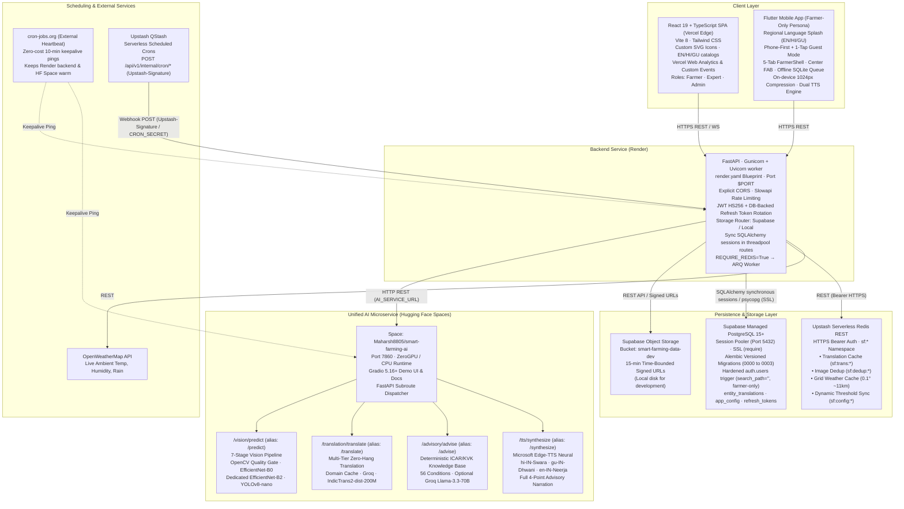
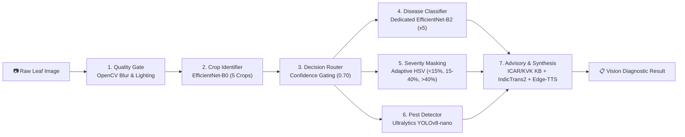
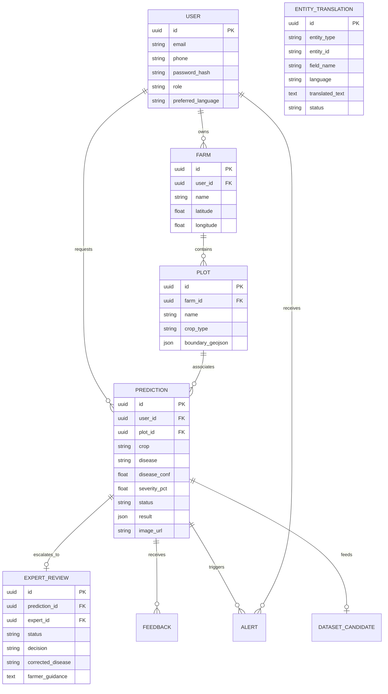
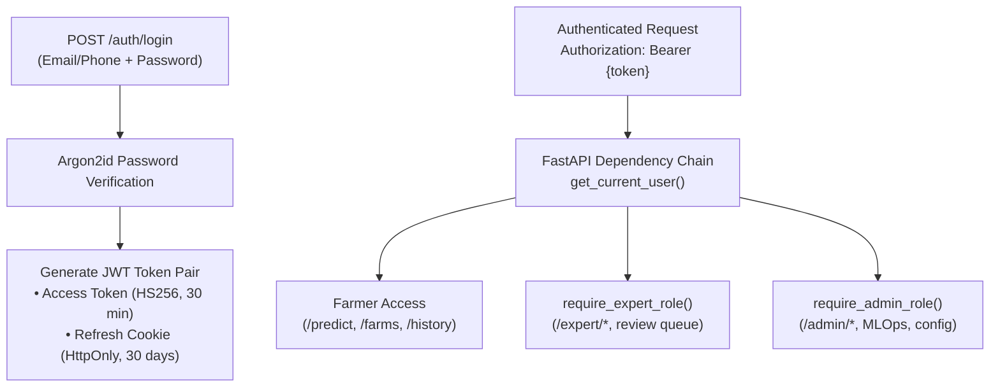
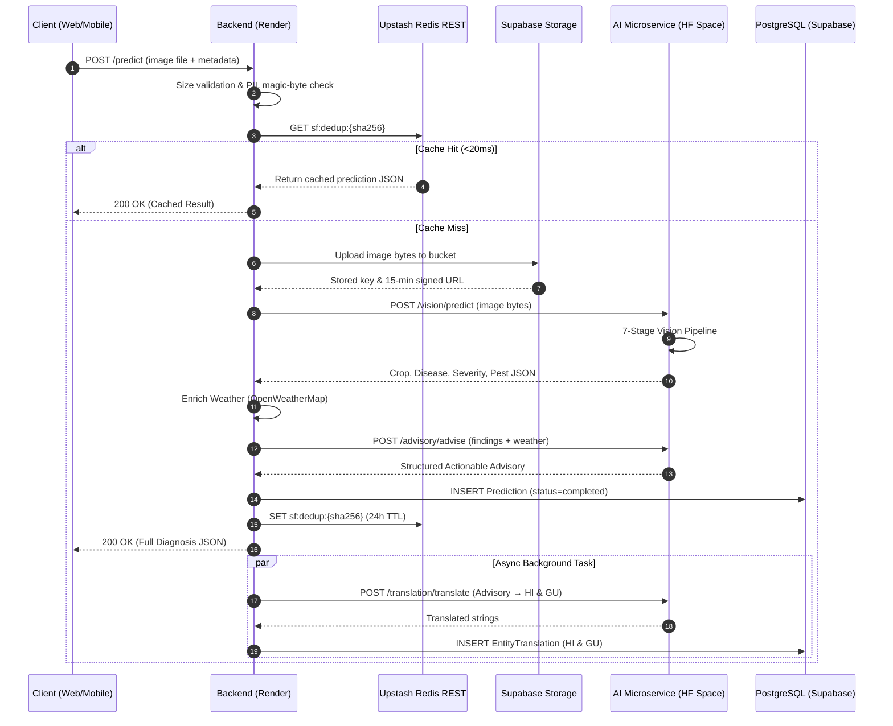
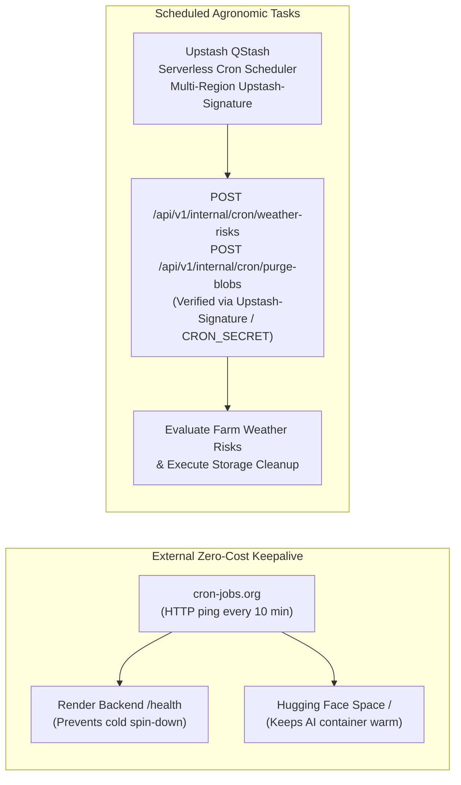
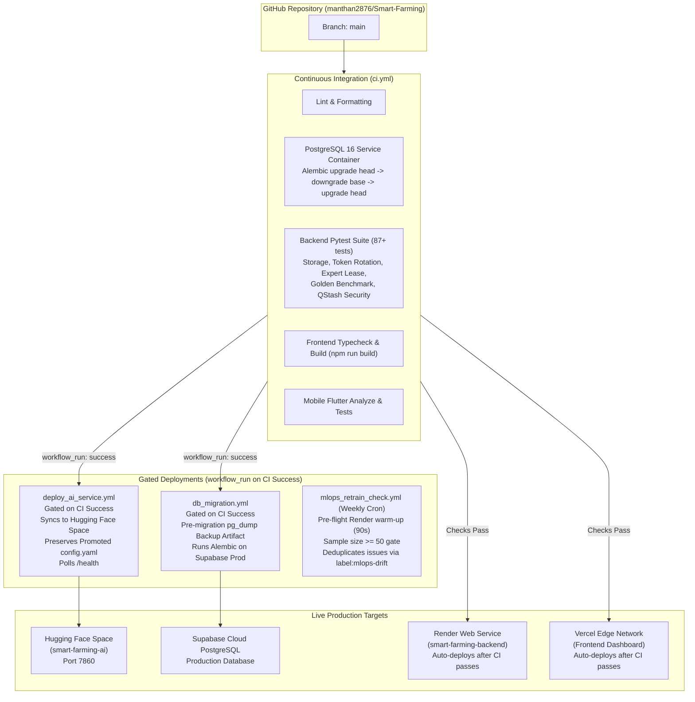

# Architecture & System Design Document

**Project:** AI-Powered Smart Farming  
**Version:** 2.3 (Hardened Monorepo, Gated CI/CD & Vercel Analytics)  
**Date:** 22 October 2026  
**Status:** Active / Production Reference  

---

## Table of Contents

1. [System Overview](#1-system-overview)
2. [High-Level Architecture](#2-high-level-architecture)
3. [Layer Breakdown](#3-layer-breakdown)
   - 3.1 [Client Layer (Web & Mobile)](#31-client-layer-web--mobile)
   - 3.2 [API Gateway & Backend (Render)](#32-api-gateway--backend-render)
   - 3.3 [Execution Model & Job Queue](#33-execution-model--job-queue)
   - 3.4 [Unified AI Microservice (Hugging Face Space)](#34-unified-ai-microservice-hugging-face-space)
   - 3.5 [Persistence & Storage Layer (Supabase & Upstash)](#35-persistence--storage-layer-supabase--upstash)
4. [Service Boundaries & Subroutes](#4-service-boundaries--subroutes)
   - 4.1 [FastAPI Backend Application](#41-fastapi-backend-application)
   - 4.2 [AI Microservice Gateway & Auto-Derivation](#42-ai-microservice-gateway--auto-derivation)
   - 4.3 [Vision Engine 7-Stage Pipeline](#43-vision-engine-7-stage-pipeline)
   - 4.4 [Storage Abstraction Layer](#44-storage-abstraction-layer)
5. [Data Models & Schema](#5-data-models--schema)
6. [Authentication & Authorization](#6-authentication--authorization)
7. [Data Flow: Scan & Predict](#7-data-flow-scan--predict)
8. [Expert Review Flow & Retraining Loop](#8-expert-review-flow--retraining-loop)
9. [Scheduler, Keepalive & Background Jobs](#9-scheduler-keepalive--background-jobs)
10. [Frontend & Mobile Architecture](#10-frontend--mobile-architecture)
11. [Infrastructure, CI/CD & Deployment](#11-infrastructure-cicd--deployment)
12. [Non-Functional Characteristics](#12-non-functional-characteristics)

---

## 1. System Overview

**AI-Powered Smart Farming** is a full-stack, production-grade crop disease diagnostic and agronomic intelligence platform designed for Indian agriculture. A farmer photographs a diseased plant leaf using their mobile phone or web browser; within seconds the platform identifies the crop, classifies the specific pathogen or condition, estimates infection severity, detects pests, ingests live local weather metrics, and delivers actionable, agronomist-validated treatment recommendations in the farmer's preferred language (**English, Hindi, or Gujarati**) complete with synchronized neural audio narration.

The system is architected around five core tenets:

| Tenet | Implementation |
|---|---|
| **Diagnostic Accuracy** | 7-stage vision ensemble (OpenCV quality gate, EfficientNet-B0 crop classifier, dedicated per-crop EfficientNet-B2 disease classifiers across 32 conditions, adaptive HSV lesion severity calculation, and Ultralytics YOLOv8-nano pest detection) with automatic uncertainty escalation to human experts |
| **Decoupled Serverless Scalability** | Lean API gateway hosted on Render web service paired with a consolidated AI microservice deployed on Hugging Face Spaces (running Gradio 5.16+ and FastAPI on port `7860`) |
| **Complete Traceability** | Every diagnostic inference carries an immutable `provenance` block recording exact model versions, weights hash, latency breakdown, and fallback flags |
| **Multilingual Experience** | English, Hindi, and Gujarati catalogs plus remote translation and speech services; untranslated inline UI copy remains a known coverage gap |
| **Storage & Data Abstraction** | Production-default Supabase Object Storage with time-bounded signed URLs (15-min expiry), plus local disk for development; legacy `s3` is an alias for Supabase |

---

## 2. High-Level Architecture



---

## 3. Layer Breakdown

### 3.1 Client Layer (Web & Mobile)

The client tier comprises two dedicated frontends:

#### 1. React Web Dashboard (`frontend/`)
- **Framework:** React 19 + TypeScript 7 bundled via Vite 8 (versions are resolved by `frontend/package-lock.json`).
- **Styling:** Tailwind CSS with a distinctive anti-vibecoded aesthetic: sharp corners (`rounded-sm`), subtle border elevations, high-contrast farmer-green and warm neutral palettes.
- **Iconography:** Lucide React icon components.
- **Routing:** React Router v7 featuring role-guarded route trees (`farmer`, `expert`, `admin`) with lazy-loaded pages.
- **State & Communication:** `AuthContext` (JWT session, profile data, active language), `ThemeContext`, a centralized Fetch API client with automatic 401 token refresh, TanStack Query for server state, and native WebSocket connectivity for live pipeline progress.
- **i18n & Localization:** English, Hindi, and Gujarati catalogs have compile-time key parity, alongside runtime domain translators (`domain.ts`). Not all static UI copy is routed through the catalogs yet.

#### 2. Flutter Mobile Application (`mobile/`)
- **Framework:** Flutter 3.x / Dart.
- **Architecture:** A custom `ChangeNotifier`/`InheritedNotifier` locale state provider with a unified 5-tab bottom navigation shell (`FarmerShell`).
- **Dynamic Discovery:** Reads backend endpoint dynamically from the Supabase `public.app_config` table (`key='api_base_url'`) via `RemoteConfigService`, eliminating hardcoded URLs in app builds.
- **Field GIS & Offline Capability:** Center-crosshair GIS polygon field boundary drawing screen with magnetic snapping, and local SQLite/SharedPreferences offline queue for low-connectivity rural field scouting.

---

### 3.2 API Gateway & Backend (Render)

The FastAPI application (`backend/src/app/main.py`) acts as the central orchestrator and security boundary.

| Concern | Implementation |
|---|---|
| **Hosting & Runtime** | Deployed on **Render** as a web service via [`render.yaml`](file:///home/manthan/Projects/Smart-Farming/render.yaml) (`uvicorn src.app.main:app --host 0.0.0.0 --port $PORT`) |
| **Startup & Cold Start** | Async non-blocking startup lifespan (`lifespan`): Database verification is pushed to background tasks in production to guarantee immediate port binding (<1s) and prevent health check timeouts |
| **Security & Auth** | Dual-token authentication: Short-lived HS256 JWT access tokens (30 min) via `Authorization: Bearer` header, paired with 30-day `HttpOnly` refresh cookies (`SameSite=Strict`). Password hashing via Argon2id (`pwdlib[argon2]`) |
| **Rate Limiting** | `slowapi` in-memory token bucket per remote client IP (e.g., login capped at 5 req/min, scan at 20 req/min) |
| **CORS Middleware** | Configurable origins whitelist supporting production Vercel frontends (`allow_origin_regex` for `*.vercel.app` and localhost dev) |
| **Storage Gateway** | Transparent asset streaming endpoint `/data/{file_path}`: checks local cache first, then seamlessly streams or generates signed URLs from Supabase Object Storage |

---

### 3.3 Execution Model & Job Queue

The backend supports two runtime execution modes controlled by the `REQUIRE_REDIS` configuration toggle:

#### Mode A: Synchronous Microservices (Production Default — `REQUIRE_REDIS=False`)
To avoid persistent Redis polling daemons that burn through free-tier compute hours, production uses synchronous microservice invocation:
1. `POST /predict` receives the multipart leaf image upload.
2. File validation runs: size limit check (`UPLOAD_MAX_BYTES`, default 10MB) followed by binary PIL magic-byte verification (`Image.verify()`) to prevent MIME-type spoofing.
3. **Upstash Dedup Check:** Computes SHA-256 hash of image bytes and queries Upstash Redis REST (`sf:dedup:{hash}`). On cache hit (24h TTL), returns the cached diagnosis in <20ms.
4. The validated image is committed to **Supabase Object Storage** (`smart-farming-data-dev`) via REST API with a time-bounded signed URL.
5. **Unified AI Microservice Invocation:** The backend issues an HTTP request to `AI_SERVICE_URL` (`/vision/predict`).
6. The AI microservice executes the 7-stage vision pipeline and returns crop, disease, severity, and pest findings.
7. Weather enrichment is fetched via OpenWeatherMap (cached for 30 minutes in Upstash under `sf:weather:{lat}:{lon}`).
8. Agronomic advisory recommendations are generated via local Qwen2.5-1.5B or Groq Llama-3.3-70B, verified against ICAR/KVK agricultural safety rules.
9. FastAPI `BackgroundTasks` dispatches parallel translation of the advisory into Hindi and Gujarati, persisting outputs to the `entity_translations` table in PostgreSQL.
10. The complete diagnostic record is saved to PostgreSQL, mirrored into `sf:dedup:{hash}`, and returned to the client with `200 OK`.

#### Mode B: Asynchronous Worker Queue (`REQUIRE_REDIS=True`)
For dedicated host environments with local Redis:
- `POST /predict` writes a `processing` record to the database and enqueues an ARQ job.
- An ARQ worker executes `run_pipeline(context)` in the background.
- Each pipeline stage publishes an event to Redis pub/sub, which the API gateway streams to the client over WebSocket (`/ws/predictions/{id}`).

---

### 3.4 Unified AI Microservice (Hugging Face Space)

All heavy machine learning and generative AI workloads are consolidated into a single dedicated microservice housed in `ai_service/`:

- **Deployment Target:** Hugging Face Space (`Maharsh8805/smart-farming-ai`), hosted at `https://maharsh8805-smart-farming-ai.hf.space`.
- **Port & Protocol:** Binds strictly to port `7860` (the standard Hugging Face container port).
- **Dual Interface:**
  1. **Gradio 5.16+ Interactive Dashboard:** Root `/` provides a live web UI for agronomists and developers to test leaf diagnosis, translation, advisory, and speech synthesis interactively.
  2. **FastAPI REST Endpoints:** Mounts high-performance API subroutes (`/vision`, `/translation`, `/advisory`, `/tts`, `/health`).
- **Hardware Acceleration:** Dynamically detects GPU availability (`SPACES_ZERO_GPU` / CUDA) with thread-tuned PyTorch CPU execution for consistent REST responsiveness.

---

### 3.5 Persistence & Storage Layer (Supabase & Upstash)

| Store | Purpose | Technology & Specifications |
|---|---|---|
| **Relational Database** | User accounts, farms, plots, predictions, expert reviews, feedback, alerts, dataset candidates, MLOps runs | **Supabase Managed PostgreSQL 15+** connected via Session Pooler (port `5432`) with mandatory SSL (`sslmode=require`). Versioned with Alembic migrations. |
| **Object Storage** | Raw leaf uploads, processed Grad-CAM heatmaps, and audio | **Supabase Object Storage** (default bucket: `smart-farming-data-dev`). Access managed via time-bounded signed URLs (default 900s / 15 min); local disk is used for development. The `s3` backend value is a legacy alias, not a separate AWS implementation. |
| **Serverless Redis REST** | Sub-20ms translation caching, prediction image deduplication, dynamic ML threshold sync, weather caching, cron locking | **Upstash Serverless Redis REST** (`sf:*` namespace). Communicates purely over HTTPS token-authenticated REST calls; zero persistent TCP sockets required. |
| **Entity Translations** | Structured table for pre-translated multilingual entity fields (advisory, expert guidance) | **Supabase PostgreSQL `entity_translations` table** — indexed by `(entity_type, entity_id, field_name, language)`. |
| **Remote App Config** | Dynamic mobile backend discovery | **Supabase PostgreSQL `public.app_config` table** with PostgREST read-only access for client applications. |

---

## 4. Service Boundaries & Subroutes

### 4.1 FastAPI Backend Application

**Entry Point:** `backend/src/app/main.py`

Registers 17 modular endpoint routers:
- `/auth` — User registration, login, 1-tap guest login (`/auth/guest`), DB-backed token refresh (`/auth/refresh`), password reset via SMTP, password update
- `/profile` — User profile, location, language preference
- `/farm` — Farm creation, plot boundary polygons, soil details
- `/predict` — Image upload, validation, deduction check, sync pipeline / ARQ dispatch
- `/history` — Paginated diagnostic history, date filtering, crop filters
- `/feedback` — Farmer feedback on diagnosis accuracy
- `/weather` — Live meteorological data, 30-min Upstash cached (0.1° grid rounded)
- `/crops` — Catalogue of supported crops and their pathogens
- `/health` — Health check reporting DB connectivity and AI service status
- `/alerts` — Push and in-app alerts (weather risk, expert review updates)
- `/admin` — System metrics, user role management, threshold config hot-reload, MLOps exports
- `/expert` — Expert triage queue, side-by-side review, atomic claiming (15-min lease lock), label override
- `/internal/cron` (also at `/api/v1/internal/cron`) — Multi-region QStash webhook receiver for scheduled jobs (`/weather-risks`, `/purge-blobs`)
- `/tts` — Audio narration dispatch, speech synthesis caching
- `/translation` — Dynamic prediction advisory translation (`POST /predictions/{id}/translate`)
- `/mlops` — Retraining pipeline trigger and dataset candidate curation (spatial split, 70/30 replay)
- `/model-registry` — Model performance telemetry, calibrated temperature $T$, and version promotion

All HTTP routers are exposed under canonical `/api/v1` paths for new consumers and OpenAPI generation. Existing unversioned paths remain hidden compatibility aliases to avoid breaking deployed clients; retire them only after an announced sunset and a mobile-client compatibility review.

---

### 4.2 AI Microservice Gateway & Auto-Derivation

In `backend/src/app/core/config.py`, the backend maintains a **single source of truth** for all AI capabilities:

```python
AI_SERVICE_URL: str = "https://maharsh8805-smart-farming-ai.hf.space"
```

All subroute URLs are automatically derived via Pydantic model validators:

| Service Subroute | Derived Endpoint | Direct Alias | Responsibility |
|---|---|---|---|
| `MODEL_SERVER_URL` | `{AI_SERVICE_URL}/vision` | `/predict` | Quality gate, crop identification, per-crop disease diagnosis, severity, pest detection |
| `TRANSLATION_SERVER_URL` | `{AI_SERVICE_URL}/translation` | `/translate` | IndicTrans2 translation (English $\to$ Hindi, Gujarati) with multi-tier zero-hang cache |
| `ADVISORY_SERVER_URL` | `{AI_SERVICE_URL}/advisory` | `/advise` | Grounded agronomic advisory via `advisory_kb.json` (56 conditions) & Groq Llama-3.3-70B |
| `TTS_SERVER_URL` | `{AI_SERVICE_URL}/tts` | `/synthesize` | Microsoft Edge-TTS neural speech synthesis (Dhwani, Swara, Neerja) |

> [!NOTE]
> The configuration validator automatically detects and purges any legacy tunnel patterns (such as `trycloudflare.com`, `workers.dev`, or `ngrok`), ensuring traffic always routes to the consolidated Hugging Face Space. Direct root aliases (`/predict`, `/translate`, `/advise`, `/synthesize`) are exposed at the FastAPI root for zero-overhead routing.

---

### 4.3 Vision Engine 7-Stage Pipeline

Located in `ai_service/vision_engine/`:



1. **Quality Gate & Preprocessing (`preprocessing.py`):** Binary integrity verification, Laplacian variance sharpness check (`blur_var > 50`), mean luminance check (`40–240`), and greenness/leaf ROI verification. Rejects unreadable inputs before neural computation.
2. **Crop Identifier (`crop_identifier.py`):** EfficientNet-B0 multi-class classifier identifying the crop species across 5 major Indian cash crops (Tomato, Potato, Cotton, Groundnut, Pepper Bell) with 99.2% Top-1 accuracy.
3. **Decision Router (`decision_router.py`):** Evaluates crop identification confidence against the configured threshold (`0.70`). Routes the leaf to the dedicated crop model or marks for agronomist review if ambiguous.
4. **Disease Classifier (`disease_classifier.py`):** Dedicated per-crop EfficientNet-B2 classifiers (5 models) evaluating 32 specific disease and healthy conditions with temperature-calibrated probabilities. Predictions below `0.70` are flagged for expert escalation.
5. **Severity Masking (`severity.py`):** Adaptive HSV color segmentation measuring the exact percentage of affected leaf surface area and categorizing infection into standardized tiers (`Healthy 0%`, `Low <15%`, `Medium 15–40%`, `High >40%`).
6. **Pest Detector (`pest_detector.py`):** Ultralytics YOLOv8-nano multi-class pest detector identifying agricultural insect damage (Aphid, Army Worm, Leaf Miner, Spider Mite) with graceful degradation when weights are omitted.
7. **Agronomic Advisory & Regional Synthesis:** Deterministic ICAR/KVK agronomic advisory knowledge base (`advisory_kb.json`, 56 conditions) with optional Groq Llama-3.3-70B synthesis, multi-tier zero-hang translation (IndicTrans2 dist-200M), and Microsoft Edge-TTS full 4-point neural narration.

---

### 4.4 Storage Abstraction Layer

Defined in `backend/src/app/core/storage.py`, `StorageBackend` provides a uniform interface:

```python
class StorageBackend(ABC):
    def save(self, content: bytes, destination_key: str, content_type: str) -> str: ...
    def get(self, key: str) -> bytes: ...
    def get_url(self, key: str, expires_in: int = 900) -> str: ...
    def delete(self, key: str) -> bool: ...
    def exists(self, key: str) -> bool: ...
    def list_objects(self, prefix: str = "") -> list[str]: ...
```

- **`SupabaseStorageBackend` (Default in Production):** Uploads via Supabase Storage REST API with `x-upsert: true` and generates signed URLs with 15-minute expiration.
- **`LocalStorageBackend`:** Stores files under `backend/data/` for local offline development.
- **`S3StorageBackend`:** Legacy alias for the Supabase-compatible storage implementation.

---

## 5. Data Models & Schema



---

## 6. Authentication & Authorization



### Role Hierarchy
$$\text{admin} \supset \text{expert} \supset \text{farmer}$$

- **Farmer:** Default role upon registration. Can upload leaf scans, view personal diagnostic history, manage farms and plots, and receive alerts.
- **Expert:** Inherits farmer permissions. Access to the expert review triage queue, ability to override or confirm AI diagnoses, and provide customized guidance.
- **Admin:** Inherits expert permissions. Access to system health telemetry, MLOps dataset candidate exports, dynamic configuration hot-reloading, and user management with anti-lockout guards.

---

## 7. Data Flow: Scan & Predict



---

## 8. Expert Review Flow & Retraining Loop

When a prediction's confidence falls below the configured threshold (`0.70`) or the crop is ambiguous:
1. `ensure_expert_review()` sets `Prediction.status = "pending_expert_review"` and creates an `ExpertReview` entry.
2. An alert is created notifying the farmer that an agronomist is verifying their scan.
3. Agronomists view the queue via `GET /expert/queue` and review images side-by-side with Grad-CAM heatmaps.
4. The expert submits a decision via `POST /expert/reviews/{id}`:
   - **Approve:** Confirms AI finding $\to$ `status = "verified"`.
   - **Override:** Corrects disease label or severity $\to$ `status = "verified"`.
   - **Request Rescan:** Flags poor quality/occlusion $\to$ `status = "rescan_requested"`.
5. If flagged with `add_to_retraining=true`, an entry is written to `DatasetCandidate`, automatically feeding the MLOps retraining cycle.

---

## 9. Scheduler, Keepalive & Background Jobs



1. **Keepalive Pings:** Scheduled external HTTP GET requests via `cron-jobs.org` prevent Render and Hugging Face Free Spaces from spinning down during business hours.
2. **QStash Serverless Crons:** Durable webhooks trigger periodic weather evaluations (`/api/v1/internal/cron/weather-risks` at `0 6,12,18 * * *`) and storage hygiene (`/api/v1/internal/cron/purge-blobs` weekly at `0 3 * * 0`) without requiring an always-on Celery or ARQ daemon. Each request is cryptographically validated via `Upstash-Signature` (HS256 with key rotation and payload body hash integrity).
3. **Upstash Distributed Locks:** Prevents duplicate concurrent executions using atomic Redis keys (`sf:cron:last_weather_eval`).

---

## 10. Frontend & Mobile Architecture

### Frontend Navigation Matrix

| Path | Component | Guard / Access | Description |
|---|---|---|---|
| `/` | `LandingPage` | Public | Interactive product presentation & live diagnostic demo |
| `/scan` | `ScanPage` | Farmer+ | Leaf photo upload, camera capture, real-time diagnostic launcher |
| `/predictions/:id` | `PredictionResultPage` | Farmer+ | Complete report: disease, severity, pests, audio narration, translation toggle |
| `/history` | `HistoryPage` | Farmer+ | Paginated diagnostic log with search and crop filtering |
| `/weather` | `WeatherPage` | Farmer+ | Real-time weather, spray condition advisories, neural voice playback |
| `/farm/settings` | `FarmSettingsPage` | Farmer+ | Interactive Google Maps GIS boundary polygon creator |
| `/admin/expert` | `ExpertQueuePage` | Expert+ | Agronomist triage desk for low-confidence scans with 15-min lease locking |
| `/admin/expert/:id`| `ExpertReviewPage` | Expert+ | Side-by-side diagnostic validation and override interface |
| `/admin/metrics` | `AdminMetricsPage` | Admin only | System-wide ML telemetry, drift monitoring, active models |
| `/admin/users` | `AdminUsersPage` | Admin only | User directory and role management with safety locks |

### Frontend Telemetry & Vercel Web Analytics
The web application integrates `@vercel/analytics` (`frontend/src/lib/analytics.ts` and `<Analytics />` in `App.tsx`) for privacy-preserving client-side observability:
- **Automatic Route Tracking:** Tracks SPA page transitions (`react-router-dom`) without requiring custom routing hooks.
- **Custom Event Telemetry:** Dispatches type-safe events for critical user actions (`scan_initiated`, `offline_sync_completed`, `prediction_viewed`, `feedback_submitted`, `expert_review_requested`, `language_changed`, `auth_action`).
- **Zero-Cookie & Zero-PII:** Operates without tracking cookies, never logging personal data (passwords, emails, phone numbers, or exact coordinates).

### Mobile Architecture (Flutter)
The mobile app is strictly tailored to the **Farmer persona**:
- **Regional Language Splash:** High-contrast regional selection cards (`Gujarati`, `Hindi`, `English`) on launch.
- **Phone-First Auth + 1-Tap Guest Mode:** Instant scan without mandatory registration (`POST /api/v1/auth/guest`).
- **5-Tab FarmerShell:** Bottom navigation (`Today`, `History`, Center Hero Camera FAB, `Farm`, `Settings`).
- **Offline SQLite Queue:** Scans taken in poor connectivity are queued locally and automatically uploaded with exponential backoff on reconnection.
- **On-Device Compression:** `ImageCompressor` downsizes images to 1024px ($\le 150\text{ KB}$) with an ambient luminance quality gate.
- **Dual TTS Engine:** Edge-TTS cloud audio with instant on-device `flutter_tts` fallback.
- **Qualitative Confidence & Statutory Badges:** Green/Yellow/Orange chips (`High`, `Medium`, `Low`) and statutory Central Insecticides Board (CIB&RC) safe-handling notices.
- **Rescan Comparison:** Longitudinal side-by-side progression sheet comparing current vs prior lesion coverage.

---

## 11. Infrastructure, CI/CD & Deployment



### Active GitHub Actions Workflows
1. **`ci.yml` (Continuous Integration & Verification):**
   - Triggers on push/PR touching `backend/**`, `ai_service/**`, `frontend/**`, `mobile/**`, and `.github/workflows/**`.
   - Runs a PostgreSQL 16 container verifying Alembic reversibility (`upgrade head -> downgrade base -> upgrade head`).
   - Executes 87+ backend tests (`pytest backend/tests`), frontend build typechecking, and Flutter mobile analysis.
2. **`deploy_ai_service.yml`:**
   - Gated on `ci.yml` success via `workflow_run`.
   - Synchronizes code and model definitions while preserving active promoted `config.yaml` on the Space.
   - Polls `GET /health` with retries before completing.
3. **`db_migration.yml`:**
   - Gated on `ci.yml` success via `workflow_run`.
   - Exports an automated `pg_dump` backup uploaded as a GitHub Actions artifact (7-day retention).
   - Executes `migrate_to_prod.py --schema-only --yes` against production Supabase.
4. **`mlops_retrain_check.yml`:**
   - Weekly scheduled monitor running Monday at 06:00 UTC.
   - Pings `/health` with 90s timeout and retries to wake cold Render free-tier instances.
   - Enforces statistical sample gate ($\ge 50$ scans) before alerting.
   - Deduplicates GitHub issues by checking `label:mlops-drift` with `gh issue list`.

### Maintenance Scripts Architecture (`backend/scripts/`)

| Script | Purpose | Production Guard |
|---|---|---|
| `_common.py` | Shared database URL sanitization, environment loaders, and prompt confirmation | Refuses production writes without explicit confirmation |
| `migrate_to_prod.py` | Database schema migration CLI used by `db_migration.yml` | Requires `--schema-only --yes` in CI |
| `setup_qstash_schedules.py` | Idempotent Upstash QStash cron registration (`sf-weather-risks`, `sf-purge-blobs`) | Uses `Upstash-Schedule-Id` header |
| `check_services.py` | Non-destructive read-only health checks (Postgres, Storage, Redis REST, Auth API) | 100% read-only with auto-cleanup probe |
| `migrate_users_to_supabase_auth.py` | One-time backfill of `public.users` into Supabase Auth with pagination (>100) | Generates cryptographically unique passwords |
| `sync_user_password.py` | Synchronizes user password in Postgres Argon2 and Supabase Auth | Uses secure `getpass` prompt (no shell history exposure) |

---

## 12. Non-Functional Characteristics

### Reliability & Resilient Fallbacks
- **Graceful Vision Degradation:** If optional pest detection weights (`pest_classifier.pt`) are unmounted, the pipeline gracefully skips the stage and continues.
- **Advisory Fallback Chain:** Deterministic `advisory_kb.json` (56 verified conditions) $\to$ Groq Llama-3.3-70B $\to$ Google Gemini 2.5 Flash $\to$ Local in-memory LLM.
- **Audio Caching & Resiliency:** Audio files are cached by SHA-256 hash in local storage and mirrored to Supabase Storage, preventing repetitive re-generation.

### Geographic Reference
- **Indian Agricultural Reference:** Geographic defaults are configured to Gujarat, India (`DEFAULT_LAT = 21.7645`, `DEFAULT_LON = 72.1519`, `DEFAULT_LOCATION = "Gujarat, India"`), providing accurate meteorological context when client GPS is unavailable.

### Security
- **Strict Role-Change Guards:** Admins cannot demote themselves, nor can the last remaining admin be demoted.
- **Magic-Byte Binary Validation:** Guarantees that uploaded payloads are genuine image files before disk or cloud persistence.
- **Time-Bounded Storage Access:** Signed URLs strictly expire after 15 minutes (900s), ensuring private media assets are not exposed to unauthorized parties.

---

*AI-Powered Smart Farming — Architecture & System Design Reference*  
*Lead Developer & Model Architect: Manthan Kuvadiya*  
*Monorepo Repository: [github.com/manthan2876/Smart-Farming](https://github.com/manthan2876/Smart-Farming)*  
*Hugging Face Space: [Maharsh8805/smart-farming-ai](https://huggingface.co/spaces/Maharsh8805/smart-farming-ai)*  
*Last Updated: 19 October 2026*
