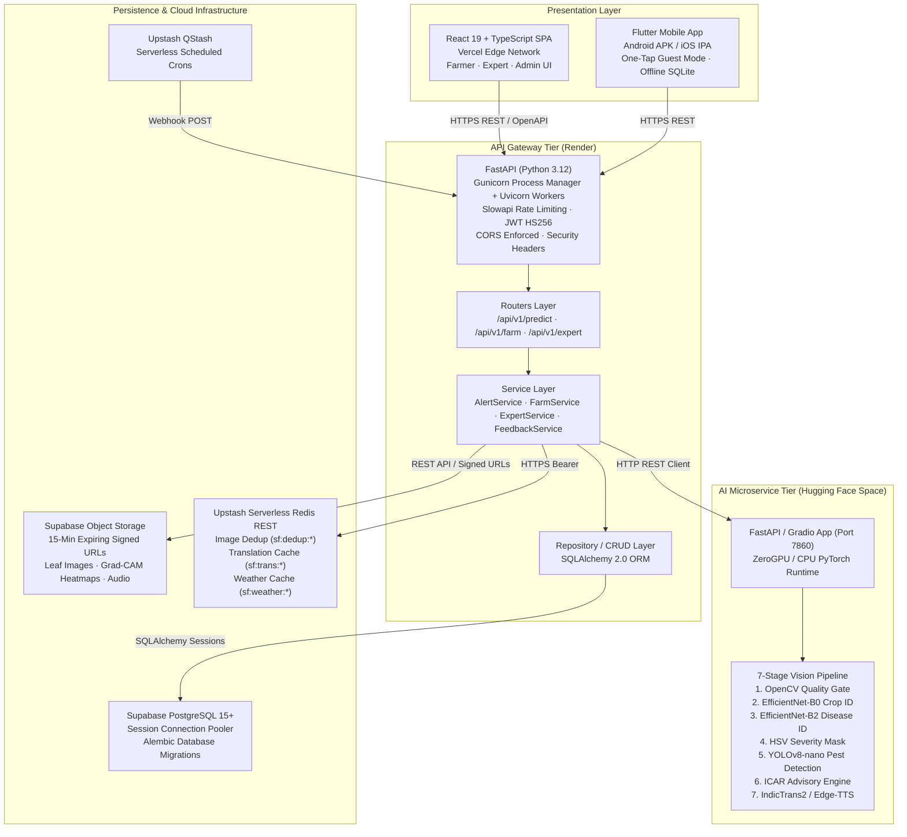
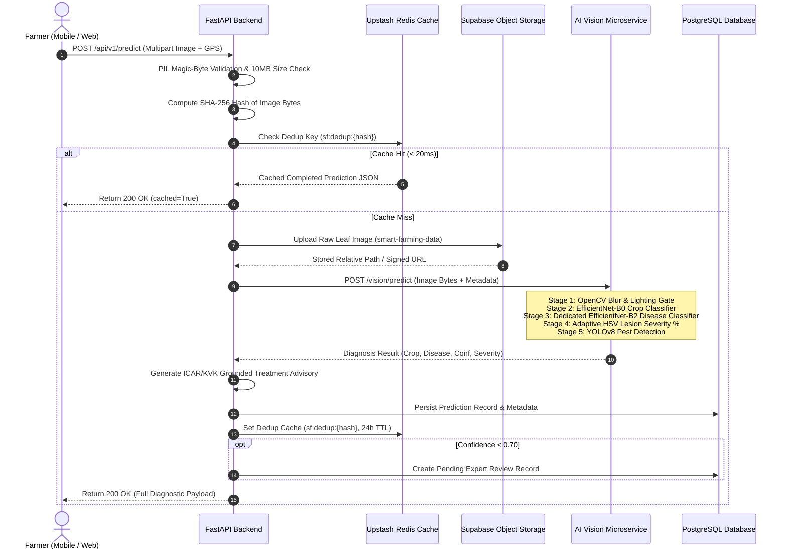
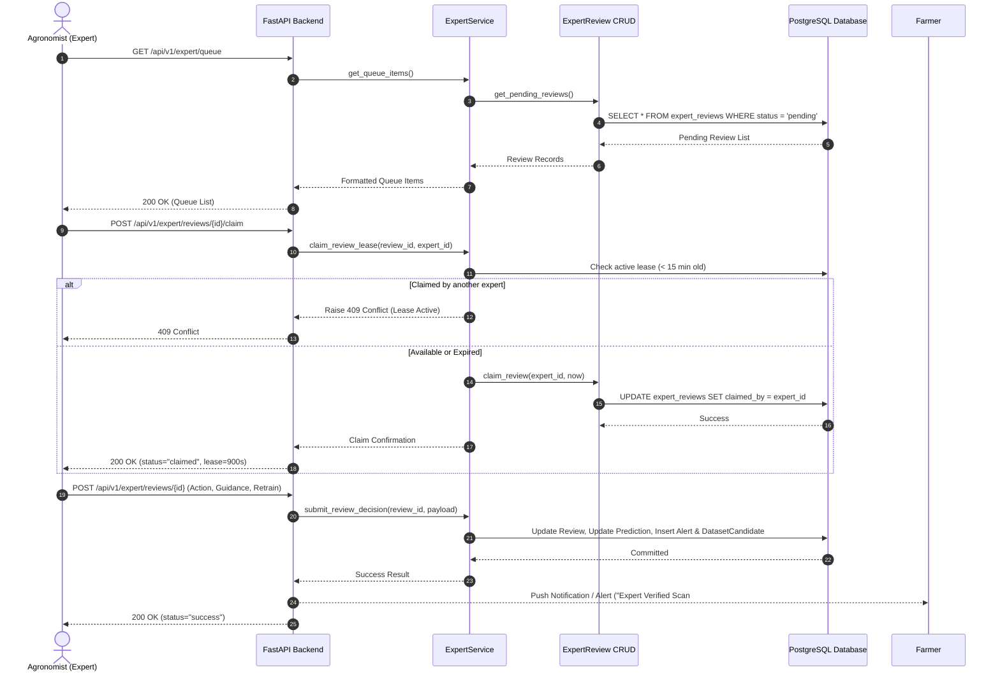
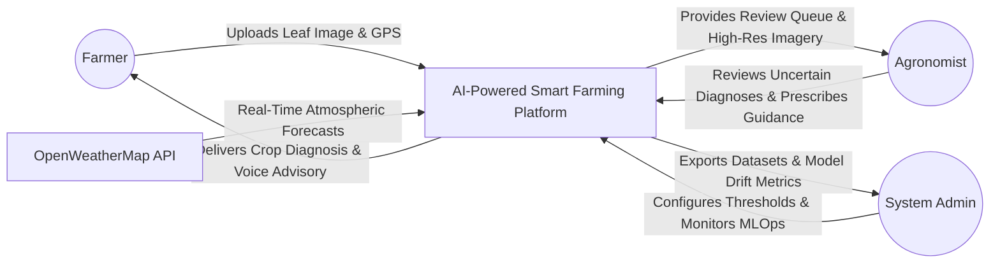
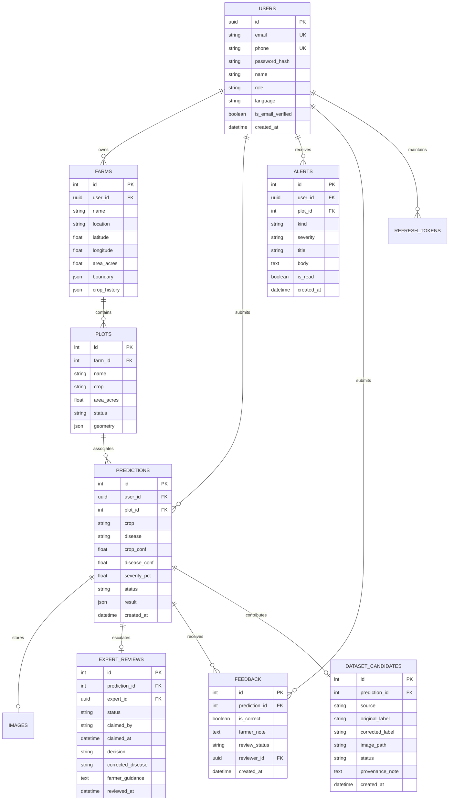

# System Design Document (SDD)
## AI-Powered Smart Farming Platform

**Degree:** Bachelor of Technology (B.Tech) in Information Technology  
**Department:** Department of Information Technology  
**Institute:** Chandubhai S. Patel Institute of Technology (CSPIT)  
**University:** Charotar University of Science and Technology (CHARUSAT), Changa, Gujarat, India  
**Academic Year:** 2026 – 2027  

**Student Contributors:**  
- **Manthan Kuvadiya** (Full-Stack Engineering & MLOps Pipeline)  
- **Kunj Lunagariya** (Computer Vision, Deep Learning & Backend Services)  

**Project Guide:**  
- **Prof. Rajnik Katariya**, Assistant Professor, IT Department, CSPIT, CHARUSAT  

**Document Version:** 1.0 (Final Academic Baseline)  
**Standard:** Conforming to IEEE Std 1016-2009 (*Systems and software engineering — Life cycle processes — Requirements definition and analysis*)

---

## 1. Architectural Overview

The **AI-Powered Smart Farming Platform** follows a modern cloud-native, decoupled microservices architecture designed to support high-throughput, low-latency foliar disease diagnostics and agronomic intelligence.



---

## 2. Sequence Diagrams

### 2.1 Leaf Diagnostic Scan & Inference Flow



### 2.2 Expert Review & Concurrency Lock Lease Flow



---

## 3. Data Flow Diagrams (DFD)

### 3.1 DFD Level 0 (Context Diagram)



### 3.2 DFD Level 1 (Functional Decomposition)

```mermaid
flowchart TD
    FARMER((Farmer)) -->|1. Leaf Photo| P1[1.0 Image Validation & Quality Gate]
    P1 -->|Valid Image| P2[2.0 7-Stage Vision Pipeline]
    P1 -->|Rejected (Blur/Dark)| FARMER
    
    P2 -->|Inference Findings| P3[3.0 Agronomic Advisory Generator]
    P3 -->|English Advisory| P4[4.0 Regional Translation & TTS Engine]
    P4 -->|Audio & Vernacular Text| FARMER
    
    P2 -->|Low Confidence < 0.70| D1[(Expert Reviews Store)]
    EXPERT((Agronomist)) <-->|Review & Correct| D1
    
    P2 -->|Prediction Record| D2[(Predictions Store)]
    D2 --> D3[(Dataset Candidates for MLOps)]
    ADMIN((Administrator)) <-->|Export Dataset & Retrain| D3
```

---

## 4. Entity-Relationship (ER) Diagram



---

## 5. Architectural Decision Records (ADRs)

### ADR-01: Adoption of Layered Architecture (Router → Service → Repository)
- **Status**: Accepted
- **Context**: Route handlers previously contained raw SQL queries, file handling, and external API requests, making testing difficult and leading to tight coupling.
- **Decision**: Enforce strict separation: Routers handle HTTP parsing/validation, Service layer owns domain business logic, and CRUD layer manages ORM persistence.
- **Consequence**: Enhances testability, eliminates code duplication, and enables isolated mock testing.

### ADR-02: FastAPI Event Loop Concurrency Model
- **Status**: Accepted
- **Context**: Mixing `async def` with blocking synchronous SQLAlchemy queries caused main thread event loop starvation.
- **Decision**: Declare SQLAlchemy-dependent endpoints as standard `def` functions. FastAPI offloads them automatically to an external worker threadpool (`run_in_threadpool`). CPU-bound ML inference is dispatched via `asyncio.to_thread` or the background ARQ worker.
- **Consequence**: Event loop remains responsive (<5ms latency for non-blocking routes) even during heavy database operations.

### ADR-03: Multi-Tiered Translation Architecture
- **Status**: Accepted
- **Context**: Pure machine translation via neural models (IndicTrans2) occasionally mistranslates critical chemical dosages or suffers cold-start timeouts.
- **Decision**: Deploy a multi-tier pipeline:
  1. Instant offline verified agronomic lexicon (0ms).
  2. Upstash Redis REST cached translations.
  3. IndicTrans2 neural model on Hugging Face Spaces.
  4. Google Translate public fallback endpoint for zero-hang availability.
- **Consequence**: Zero translation downtime while guaranteeing 100% accuracy for statutory ICAR chemical dosage warnings.

