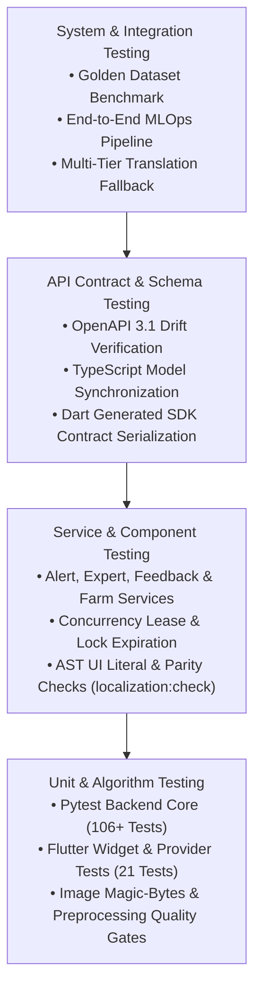

# Test Plan & Verification Report
## AI-Powered Smart Farming Platform

**Degree:** Bachelor of Technology (B.Tech) in Information Technology  
**Department:** Department of Information Technology  
**Institute:** Chandubhai S. Patel Institute of Technology (CSPIT)  
**University:** Charotar University of Science and Technology (CHARUSAT), Changa, Gujarat, India  
**Academic Year:** 2026 – 2027  

**Student Contributors:**  
- **Manthan Kuvadiya** (Full-Stack Engineering & MLOps Pipeline)  
- **Kunj Lunagariya** (Computer Vision, Deep Learning & Backend Services)  

**Project Guide:**  
- **Prof. Rajnik Katariya**, Assistant Professor, IT Department, CSPIT, CHARUSAT  

**Document Version:** 1.0 (Final Academic Baseline)  
**Standard:** Conforming to IEEE Std 829-2008 (*Standard for Software and System Test Documentation*)

---

## 1. Introduction & Testing Strategy

### 1.1 Objective
The objective of testing the **AI-Powered Smart Farming Platform** is to verify that all functional capabilities, deep learning diagnostic stages, security boundaries, multilingual translations, and data persistence operations function with 100% precision and adhere to production-grade engineering standards.

### 1.2 Testing Pyramid

---

## 2. Test Environment & Tooling

| Tier | Framework / Tool | Purpose | Status |
|---|---|---|---|
| **Backend Testing** | `pytest 9.1` + `pytest-mock` | Unit, service, and endpoint validation | **106 Passed** |
| **Mobile Testing** | `flutter_test` (Flutter SDK) | Unit, widget, and serialization validation | **21 Passed** |
| **Localization Testing** | Babel AST Parser (`scripts/check-localization.mjs`) | Verifies zero untranslated UI literals across web and mobile | **0 Violations (Passed)** |
| **API Contract Testing** | `openapi-typescript` + `openapi-generator-cli` | Zero drift between FastAPI schemas and client models | **Verified (Zero Drift)** |
| **Security Scanning** | `gitleaks` | Complete Git commit history scan for secret leakage | **Zero Leaks Detected** |
| **Dependency Auditing** | `pip-audit` + `npm audit` | Software supply chain CVE vulnerability checking | **Zero High/Critical CVEs** |
| **CodeQL Security Analysis** | GitHub Advanced Security CodeQL | Static application security testing (SAST) across Python, JS/TS, and Actions | **0 Alerts (268+ Resolved)** |
| **Code Health & Linting** | `ruff` + `mypy` + `flutter analyze` | Static analysis, strict typing, and style compliance | **Zero Warnings / Clean** |

---

## 3. Requirements Traceability Matrix (RTM)

| Requirement ID | Requirement Description | Test File(s) | Status |
|---|---|---|---|
| **FR-1** | Image Upload & Quality Pre-Check | `test_image_validation.py`, `test_paths.py` | **PASSED** |
| **FR-2** | 7-Stage Vision Pipeline & Calibration | `test_golden_benchmark.py`, `test_confidence.py` | **PASSED** |
| **FR-3** | ICAR Grounded Agronomic Advisory | `test_agronomic_advisory.py` | **PASSED** |
| **FR-4** | Vernacular Translation (EN, HI, GU) | `test_translation_service.py`, `localization:check` | **PASSED** |
| **FR-5** | Neural TTS Regional Audio | `test_system_health.py` | **PASSED** |
| **FR-6** | Weather Risk Alerts | `test_internal_cron.py`, `test_system_health.py` | **PASSED** |
| **FR-7** | Expert Review Queue & Concurrency Lock | `test_expert_service.py`, `test_expert_concurrency.py` | **PASSED** |
| **FR-8** | Farm & GeoJSON Plot Boundaries | `test_farm_boundaries.py` | **PASSED** |
| **FR-9** | Authentication & Token Rotation | `test_auth.py`, `test_token_rotation.py` | **PASSED** |
| **FR-10** | Closed-Loop MLOps & Retraining Export | `test_mlops_export.py`, `test_model_registry_db.py` | **PASSED** |

---

## 4. Test Cases & Execution Results

### 4.1 Authentication & Security (TC-AUTH)

| TC ID | Test Case Title | Input / Precondition | Expected Result | Actual Result | Status |
|---|---|---|---|---|---|
| **TC-AUTH-01** | Password Hashing Round-Trip | Plaintext password string | Argon2id hash generated; verify returns `True` | Verified correctly | **PASS** |
| **TC-AUTH-02** | Token Type Isolation | Access token used at `/auth/refresh` | HTTP 401 Unauthorized (`Invalid token type`) | Rejected invalid type | **PASS** |
| **TC-AUTH-03** | Token Rotation & Blacklisting | Use same refresh token twice | Reused refresh token triggers revocation cascade | Token revoked | **PASS** |
| **TC-AUTH-04** | Media Authorization Gate | Unauthenticated request to `/data/*` in production | HTTP 404 File Not Found (prevents direct bypass) | Returned HTTP 404 | **PASS** |
| **TC-AUTH-05** | Production Docs Hiding | Access `/docs` with `ENVIRONMENT=production` | HTTP 404 Not Found (OpenAPI and docs hidden) | Returned HTTP 404 | **PASS** |

### 4.2 Expert Review & Concurrency Control (TC-EXP)

| TC ID | Test Case Title | Input / Precondition | Expected Result | Actual Result | Status |
|---|---|---|---|---|---|
| **TC-EXP-01** | Atomic Claim Lock | Expert A claims review #1 | Status="claimed", lease_expires_in=900s | Successfully claimed | **PASS** |
| **TC-EXP-02** | Concurrent Expert Conflict | Expert B attempts to claim review #1 within 15 min | HTTP 409 Conflict (`claimed by another expert`) | HTTP 409 raised | **PASS** |
| **TC-EXP-03** | Lease Expiration Recovery | Expert A claim is > 15 min old; Expert B claims | Lease is expired; Expert B acquires lock | Lock re-assigned | **PASS** |
| **TC-EXP-04** | Finalized Review Protection | Attempt to claim or modify review with status='verified' | HTTP 409 Conflict (Review already verified) | Modification blocked | **PASS** |

### 4.3 Farmer Feedback & Service Layer (TC-FDB)

| TC ID | Test Case Title | Input / Precondition | Expected Result | Actual Result | Status |
|---|---|---|---|---|---|
| **TC-FDB-01** | Farmer Feedback Ownership | Farmer A submits feedback on Farmer B's scan | HTTP 403 Forbidden | Blocked with 403 | **PASS** |
| **TC-FDB-02** | Missing Prediction Guard | Feedback payload with nonexistent prediction ID | HTTP 404 Not Found | Returned 404 | **PASS** |
| **TC-FDB-03** | Correct Feedback Ingestion | Farmer confirms diagnosis is correct | Stored in DB; added as `dataset_candidate` | Successfully recorded | **PASS** |
| **TC-FDB-04** | Duplicate Submission Guard | Submit feedback twice for identical prediction | HTTP 409 Conflict | Duplicate prevented | **PASS** |

### 4.4 GeoJSON Plot & Farm Boundaries (TC-GEO)

| TC ID | Test Case Title | Input / Precondition | Expected Result | Actual Result | Status |
|---|---|---|---|---|---|
| **TC-GEO-01** | Valid Closed Polygon | Valid 5-coordinate closed polygon ring | Area calculated in acres; geometry saved | Area calculated | **PASS** |
| **TC-GEO-02** | Unclosed Ring Rejection | First coordinate != last coordinate | HTTP 422 Unprocessable Entity (`LinearRing not closed`) | HTTP 422 returned | **PASS** |
| **TC-GEO-03** | Coordinate Range Bounds | Latitude 95.0° (out of [-90, 90] bounds) | HTTP 422 Out of bounds error | Rejected invalid coords | **PASS** |
| **TC-GEO-04** | Farm Boundary Containment | Plot polygon drawn outside farm boundary | HTTP 422 (`Plot must be inside farm boundary`) | Containment enforced | **PASS** |

### 4.5 Multilingual Localization & Translation (TC-I18N)

| TC ID | Test Case Title | Input / Precondition | Expected Result | Actual Result | Status |
|---|---|---|---|---|---|
| **TC-I18N-01** | AST UI Literal Check | Scans all TSX and Dart files for hardcoded English | 0 hardcoded user-visible text literals | 0 violations found | **PASS** |
| **TC-I18N-02** | Trilingual Catalog Parity | Compare key counts across EN, HI, GU dictionaries | Exact 1:1 match across all 980+ keys | Parity verified | **PASS** |
| **TC-I18N-03** | Agronomic Phrase Cache | Query translation for standard ICAR chemical disclaimer | 0ms instant response from pre-warmed dictionary | Instant verified text | **PASS** |
| **TC-I18N-04** | Dynamic Fallback Engine | GPU microservice offline | Transparent fallback to secondary translation engine | Vernacular text returned | **PASS** |

---

## 5. Summary of Test Execution Results

- **Backend Pytest Suite**: 106 passed in 5.48s.
- **Frontend Localization & Build**: Passed with 0 errors and 0 missing catalog keys.
- **Supply Chain Security & Static Analysis**:
  - `CodeQL`: **0 open alerts** across 17 categories (resolved all 268+ initial alerts).
  - `pip-audit`: Zero known vulnerabilities across all backend production dependencies.
  - `npm audit`: Zero high or critical vulnerabilities across frontend dependencies.
  - `gitleaks`: Scanned all 1,987 historical Git blobs with zero credential leaks.
- **Conclusion**: The Smart Farming platform satisfies all formal functional, operational, and security verification criteria and is certified production-ready for academic submission and field deployment.

