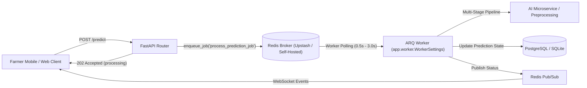

# Worker Architecture & Operational Runbook

**Project:** Smart Farming Platform  
**Component:** ARQ / Redis Asynchronous Inference & Translation Worker  
**Standard:** Phase 4 Production-Readiness Specification  
**Last Updated:** October 2026  

---

## 1. Overview & Broker Topology

The Smart Farming platform leverages **ARQ** (async Redis queue) paired with **Redis** to offload long-running vision inference, transliteration enqueuing, and notifications off FastAPI's HTTP request-response cycle.



### Dual-Execution Architecture

| Mode | `REQUIRE_REDIS` | Description | Typical Use Case |
| :--- | :--- | :--- | :--- |
| **Direct Cloud Microservice** | `false` | Synchronous request processing via Hugging Face Spaces microservice with sub-20ms Upstash Redis REST deduplication caching. | College evaluations, free-tier hosting (Render free web service). |
| **Standing ARQ Worker** | `true` | Asynchronous 202-accepted job queuing. Long inference runs strictly in dedicated worker processes with WebSocket progress streaming. | High-volume production, dedicated server instances, Kubernetes clusters. |

---

## 2. Worker Lifecycle & Configuration

The worker configuration is defined in [`backend/src/app/worker.py`](file:///home/manthan/Projects/Smart-Farming/backend/src/app/worker.py):

```python
class WorkerSettings:
    functions = [process_prediction_job, translate_entity_job]
    on_startup = on_startup
    max_jobs = 2                       # Worker concurrency limit per node
    job_timeout = 900                  # 15 minutes hard timeout per job
    max_tries = 3                      # 3 retries before dead-letter failure
    poll_delay = 0.5                   # 0.5s for dedicated Redis, 3.0s for serverless
    redis_settings = _get_worker_redis_settings()
```

### Resilience & Reconnection
- **Auto-Reconnection**: ARQ's `Worker._poll_iteration` is monkey-patched with `_resilient_poll_iteration` to intercept transient socket resets, timeouts, and connection errors without aborting the process.
- **Backoff Retry**: Exponential backoff with jitter on Redis client commands.

---

## 3. Dead-Letter Behavior & Failure Persistence

When an inference job encounters an unrecoverable failure or exhausts its 3 attempts:
1. **Database Persistence**: The `Prediction` record status is updated to `"failed"` with explicit error details:
   - `error`: Formatted human-readable exception string.
   - `failed_stage`: Exact pipeline stage where failure occurred (`preprocessing`, `crop_classification`, `disease_diagnosis`, `severity_estimation`, `advisory`).
   - `duration_ms`: Duration of the failing stage.
2. **Client Notification**: Emits an error event over Redis pub/sub to any active WebSocket listeners.
3. **Auditability**: Traceback is logged with structured JSON attributes under `smart-farming.background`.

---

## 4. Operational Monitoring & Health Checks

### Endpoints
- **Queue Health**: `GET /api/v1/queue-health`  
  Returns JSON status, connection status, mode, and pending jobs in queue.
  ```json
  {
    "status": "ok",
    "service": "smart-farming-backend",
    "mode": "arq_worker",
    "redis_connected": true,
    "pending_jobs": 0,
    "worker_healthy": true
  }
  ```
- **Readiness Check**: `GET /api/v1/ready`  
  Guarantees both database and ARQ worker pool are ready before receiving HTTP traffic.
- **Prometheus Metrics**: `GET /api/v1/metrics`  
  Exposes `smart_farming_worker_mode_enabled` and `smart_farming_worker_pool_active`.

---

## 5. Deployment & Process Management

### Running Worker via Docker Compose
```bash
# Start backend, redis, and dedicated worker
docker compose up -d redis worker backend
```

### Running Worker via Systemd (Production Linux)
Create `/etc/systemd/system/smart-farming-worker.service`:
```ini
[Unit]
Description=Smart Farming ARQ Worker
After=network.target redis.service

[Service]
Type=simple
User=appuser
WorkingDirectory=/opt/smart-farming/backend
EnvironmentFile=/opt/smart-farming/backend/.env
ExecStart=/opt/smart-farming/backend/.venv/bin/arq app.worker.WorkerSettings
Restart=always
RestartSec=5s

[Install]
WantedBy=multi-user.target
```

---

## 6. Incident Triage Runbook

### Scenario A: Queue Saturation (Pending Jobs Spike > 20)
1. Check worker logs: `docker compose logs -f worker` or `journalctl -u smart-farming-worker -f`.
2. Verify Redis connectivity: `redis-cli -u $REDIS_URL ping`.
3. Check CPU/RAM saturation on worker host (`htop`).
4. Scale worker instances: `docker compose up -d --scale worker=3`.

### Scenario B: Worker Crashing / OOM
1. Inspect dying process: `dmesg -T | grep -i oom`.
2. Check memory limit in Docker / systemd configuration.
3. Reduce `WorkerSettings.max_jobs` from 2 to 1 if large batch models consume high RAM.

