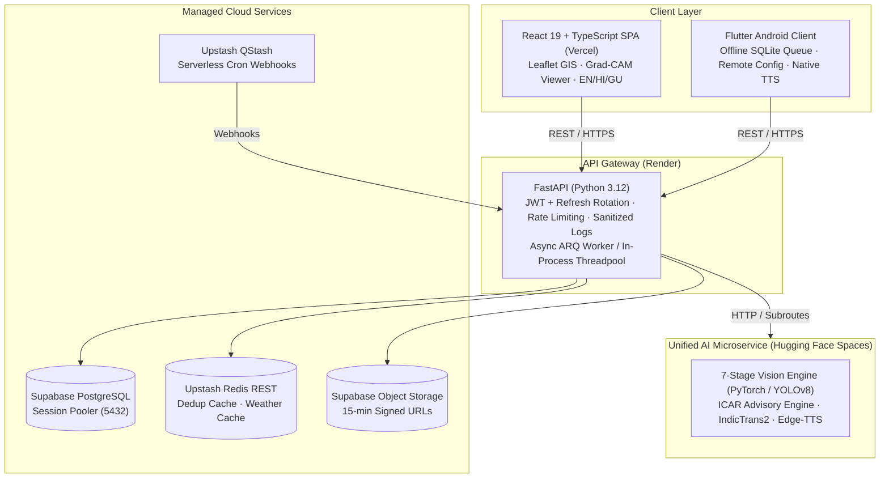

# Smart Farming: AI-Powered Crop Disease Diagnosis & Precision Agronomy

> Enterprise-grade, distributed AI platform for foliar crop disease diagnosis, pest detection, treatment recommendations, multilingual voice advisories, and precision agronomy management.

[](https://github.com/manthan2876/Smart-Farming/releases/tag/v1.0.0)
[](https://github.com/manthan2876/Smart-Farming/security/code-scanning)
[](LICENSE)
[](https://python.org)
[](https://fastapi.tiangolo.com)
[](https://react.dev)
[](https://flutter.dev)
[](https://pytorch.org)
[](https://vercel.com)
[](https://render.com)

---

## Highlights

- **7-Stage Vision Pipeline**: Validates leaf quality (OpenCV), identifies crop species (EfficientNet-B0), diagnoses diseases across 5 major cash crops (dedicated EfficientNet-B2 classifiers), estimates lesion severity (adaptive HSV), detects pests (YOLOv8), and generates transparent Grad-CAM activation heatmaps.
- **Vernacular Audio Advisories**: Delivers structured 4-point agronomic recommendations (Immediate Action, ICAR Chemical Treatment, Prevention, Monitoring) localized in English, Hindi, and Gujarati with synchronized neural Text-to-Speech (Edge-TTS).
- **Keyless GIS Field Mapping**: Interactive Leaflet maps with OpenStreetMap and high-resolution Esri satellite imagery, real-time geodesic acreage calculation, draggable polygon vertex editing, and in-place plot management.
- **Offline-First Mobile App**: Native Android Flutter app for farmers with camera viewfinder assistance, Supabase Remote Config for dynamic backend discovery, and an offline SQLite scan queue with auto-sync.
- **Human-in-the-Loop Triage**: Low-confidence diagnoses (<70%) are automatically escalated to an Agronomist Expert Queue with atomic 15-minute lease locking for expert review and label corrections.
- **Closed-Loop MLOps**: Continuous retraining loop with spatial deterministic dataset splitting (hashed on `plot_id` to eliminate rescan leakage), EXIF GPS scrubbing, and multi-format dataset exports (PyTorch, YOLO, CSV, TFRecord).
- **Hardened Security**: Zero open CodeQL alerts across 268+ checks, Argon2id password hashing, database-backed JWT refresh token rotation, signed Supabase storage URLs (15-min expiry), and encrypted mobile keychains.

---

## System Architecture



---

## Tech Stack

| Tier | Technologies | Highlights |
|---|---|---|
| **Web Frontend** | React 19, TypeScript, Vite, Tailwind CSS 4 | Keyless Leaflet GIS, Grad-CAM viewer, MLOps export dashboard, trilingual UI |
| **Mobile App** | Flutter 3.x, Dart, SQLite, `flutter_secure_storage` | Camera viewfinder, offline sync queue, crosshair GIS mapping, remote config |
| **Backend API** | Python 3.12, FastAPI, SQLAlchemy 2.0, Alembic | RESTful gateway, RBAC, threadpool execution, Zero CodeQL alerts |
| **AI Microservice** | PyTorch 2.6, timm, YOLOv8, OpenCV, Gradio | EfficientNet-B0/B2, adaptive HSV, Grad-CAM, IndicTrans2, Edge-TTS |
| **Persistence** | Supabase PostgreSQL, Supabase Storage, Upstash Redis | Connection pooling, 15-min expiring signed URLs, sub-15ms REST caching |
| **Orchestration** | Upstash QStash, ARQ, Docker, GitHub Actions | Serverless scheduled crons, async workers, gated CI/CD pipelines |

---

## Quick Start

### 1-Click Unified Runner (Linux / Pop!_OS)

To start the API Gateway, AI microservice, Frontend, and Worker concurrently:

```bash
# Launch core services:
./start_all.sh

# Or launch with Flutter mobile web:
./start_all_with_mobile.sh

# Stop all running services:
./stop_all.sh
```

- **Backend API Gateway**: `http://127.0.0.1:8000` (Docs at `/docs`)
- **Frontend Dashboard**: `http://localhost:5173`
- **AI Microservice**: `http://127.0.0.1:7860`

---

### Docker Compose

```bash
docker compose up -d
```

---

### Manual Service Setup

<details>
<summary><b>Click to expand manual setup instructions</b></summary>

#### 1. AI Microservice (`ai_service/`)
```bash
cd ai_service
python3 -m venv .venv && source .venv/bin/activate
pip install -r requirements.txt
python app.py  # Binds Gradio UI + FastAPI on port 7860
```

#### 2. Backend Gateway (`backend/`)
```bash
cd backend
python3 -m venv .venv && source .venv/bin/activate
pip install -r requirements.txt
cp .env.example .env
alembic upgrade head
uvicorn src.app.main:app --host 127.0.0.1 --port 8000 --reload
```

#### 3. Web Frontend (`frontend/`)
```bash
cd frontend
npm install
npm run dev  # Starts Vite on http://localhost:5173
```

#### 4. Mobile Client (`mobile/`)
```bash
cd mobile
flutter pub get
flutter run -d <DEVICE_ID> --dart-define-from-file=.env
```
</details>

---

## Repository Structure

```
Smart-Farming/
├── ai_service/         # Unified inference, advisory, translation & TTS microservice
├── backend/            # FastAPI API gateway, business logic, ORM models & Alembic
├── frontend/           # React 19 + TypeScript SPA with Leaflet GIS mapping
├── mobile/             # Flutter native Android application for farmers
├── Docs/               # Comprehensive architecture, API, IEEE, and operational docs
├── scripts/            # Service orchestrators, database backup/restore drills
└── docker-compose.yml  # Local container stack
```

---

## Documentation Hub

Detailed documentation is available in the [`Docs/`](Docs/) directory (see [Docs/README.md](Docs/README.md) for the master index):

### Architecture & Engineering
- [**System Architecture**](Docs/Architecture.md) — Comprehensive technical specification, data flows, and infrastructure models.
- [**API Specification**](Docs/API_Specification.md) — Canonical REST API documentation, `/api/v1` routes, and request/response contracts.
- [**Configuration Reference**](Docs/Config_Reference.md) — Complete environment variables and `config.yaml` dictionary.
- [**Authentication & Roles**](Docs/Auth_Roles.md) — RBAC matrix, token rotation lifecycle, and Supabase Auth triggers.
- [**UI / UX Design System**](Docs/UI_UX_Spec.md) — Anti-vibecoded design system tokens, components, and route layout.

### Academic Specifications & IEEE Standards
- [**Software Requirements Specification (SRS)**](Docs/SRS.md) — Conforming to IEEE Std 830-1998.
- [**System Design Document (SDD)**](Docs/Design_Document.md) — Conforming to IEEE Std 1016-2009.
- [**Test Plan & Verification Report**](Docs/Test_Plan.md) — Conforming to IEEE Std 829-2008 (106+ backend tests, 0 CodeQL alerts).
- [**Academic IEEE Report & LaTeX Suite**](Docs/report/README.md) — Conference paper source (`main.tex`) and publication PDF (`main.pdf`).
- [**University Publication Scope Charter**](Docs/Publication_Scope.md) — Capstone governance under CHARUSAT University.

### Operations & Production Runbooks
- [**Production Readiness Audit**](Docs/Production_Readiness_Audit.md) — Security audits, hardening logs, and verification snapshots.
- [**Deployment Guide**](Docs/Deployment_Guide.md) — Cloud production deployment runbook (Render, HF Spaces, Vercel, Supabase).
- [**User & Operations Manual**](Docs/User_Manual.md) — Complete walkthrough for Farmers, Agricultural Experts, and Administrators.
- [**Worker Architecture Runbook**](Docs/Worker_Architecture_Runbook.md) — ARQ worker topology, Redis broker, and queue monitoring.
- [**Backup & Disaster Recovery Runbook**](Docs/Backup_Restore_Runbook.md) — Automated database backups and SHA-256 verification.
- [**Incident Management Runbook**](Docs/Incident_Runbook.md) — SEV-1 to SEV-3 severity classifications and fast recovery checklists.

### Machine Learning & Datasets
- [**Model Cards**](Docs/Model_Cards.md) — Benchmark accuracy, architectures, and limitations across all 7 loaded models.
- [**MLOps Retraining Pipeline**](Docs/MLOps_Retraining.md) — Continuous retraining loop, candidate curation, and model promotion.
- [**Dataset Documentation**](Docs/DATASET.md) — Dataset provenance, merging methodology, and environment categorization.

---

## License & Academic Attribution

This project is licensed under the **Apache License, Version 2.0** — see the [LICENSE](LICENSE) file and [NOTICE](NOTICE) for full terms and third-party attributions.

### Academic Citation
Developed as an academic capstone project in the **Department of Information Technology, CSPIT, CHARUSAT University** under the guidance of **Prof. Rajnik Katariya**.

```bibtex
@misc{kuvadiya2026smartfarming,
  author = {Manthan Kuvadiya and Kunj Lunagariya},
  title = {AI-Powered Smart Farming: Crop Identification, Disease Diagnosis, and Context-Aware Advisory},
  year = {2026},
  howpublished = {\url{https://github.com/manthan2876/Smart-Farming}},
  note = {Department of Information Technology, CSPIT, CHARUSAT University. Project Guide: Prof. Rajnik Katariya}
}
```

---

*AI-Powered Smart Farming Platform • v1.0.0 Production Release • October 2026*
